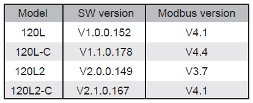

[](https://www.gnu.org/licenses/gpl-3.0) [](https://shop.svenar.nl)

ESPHome-powered controller for Midea heat pumps (including clones) that integrate seamlessly with Home Assistant.

---


- **Comprehensive Climate Control**
  - 🌡️ Heat/Cool/Auto operational mode control
  - 🏠 Home Assistant integration via native ESPHome API
  - 📈 Rich insights: temperatures, outdoor pressure, flow, voltage/current, and compressor data
  - ⚡ Energy insights with electricity consumption, power output, and calculated COP*
  - 🧭 Dual-zone support with separate heating/cooling emission type settings
  - 🚨 Diagnostics for active and historical fault registers
  - 🔧 Built-in local web UI
  - 🔄 Automatic firmware updates (Using ESPHome-builder)
  - ... and more


\* COP values reported by the heat pump may differ from the actual COP due to a known issue in the heat pump itself. For accurate measurements, use an external power meter. This requires additional hardware and is not directly integrated with this controller.

---


## R32
Commonly tested models are listed below, but this is not an exhaustive list.

__Using:__ `models/midea-R32-generic.yaml`
- [Midea R32] MHA-VxxW/D2N8
- [Midea R32] MHC-VxxW/D2N7
- [Midea R32] MHC-VxxW/D2N8
- [Midea R32] MHC-VxxW/D2RN8
- [Clivet R32] WiSAN-YME 1 S x.x
- [Clivet R32] WiSAN-YME 1 S x.xT
- [Clivet R32] MiSAN-YEE 1 S x.x
- [Worchester Bosch R32] CS2000AWFxxRS
- [Worchester Bosch R32] CS2000AWFxxRT

__Using:__ `models/midea-R32-airwell.yaml`
- [Airwell R32] AW-WHPMAxx - Hxx
- [Airwell R32] AW-YHPSAxx - Hxx

## R290
Community-tested support; no specific models are listed yet.

__Using:__ `models/midea-R290-generic.yaml`
- Midea R290 models and clones

__Using:__ `models/midea-R290-ferroli.yaml`
- Ferroli R290 models

*Note: `KJRH-120L2` is currently unsupported because it uses a different Modbus protocol version.*


---


Recommended hardware:
* ESP32 board
  * MAX485 board for Modbus communication
* 12V -> 3.3V converter (to power the ESP32 from the heat pump display)

For plug-and-play solutions, visit [shop.svenar.nl](https://shop.svenar.nl)

---


## Using ESPHome CLI

https://esphome.io/guides/cli.html

```sh
$ esphome build models/midea-R32-generic.yaml
$ esphome upload models/midea-R32-generic.yaml
```


## Using ESPHome-builder

https://esphome.io/guides/getting_started_hassio.html

1. Install the __ESPHome-builder__ add-on inside Home Assistant
2. Add the `models/midea-R32-generic.yaml` config (or any other config in the `models/` directory)
3. Build and upload

---


Based on the original work by my dad, [Mosibi](https://github.com/Mosibi/Midea-heat-pump-ESPHome), with adaptations for the hardware sold at [shop.svenar.nl](https://shop.svenar.nl).

If you are using your own hardware, I recommend Mosibi's repository. This repository stays aligned with upstream via patch files in `patcher/patches/` and adds support for a hardware factory-reset button plus status LEDs for Wi-Fi and Home Assistant connectivity.

---


**License**: GNU General Public License v3.0 - See [LICENSE](LICENSE) for details.